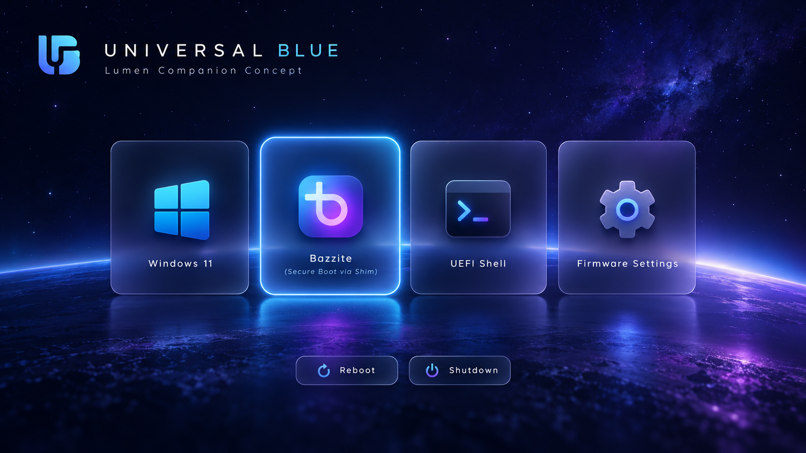

# Universal Blue Cosmic Lumen — rEFInd Theme

A **4K Universal Blue cosmic rEFInd theme** inspired by [rEFInd Lumen](https://github.com/shoxjaxon-atabayev/rEFInd-lumen), with a starfield, neon horizon, and the original [refindTTT](https://github.com/gutlessCGH/refindTTT) transparent-label icon system.

> **Status: experimental, untested on physical UEFI firmware.** The approved concept and existing composition preview are earlier **glass-card mockups**, not real rEFInd screenshots and **not previews of this refindTTT icon variant**. Boot-test and inspect the real menu before merging.



## Assets

- `background.png`: original **3840×2160 RGB** Universal Blue starfield / glowing planetary horizon **unchanged by this update**; the wallpaper has no baked-in boot icons or function buttons.
- `icons/os_bazzite.png`: original [refindTTT](https://github.com/gutlessCGH/refindTTT) Bazzite **256×256 RGBA** icon.
- `icons/os_win.png` and Windows aliases `os_win11.png`, `os_win10.png`, `os_windows.png`: original refindTTT **256×256 RGBA** icon.
- `icons/func_firmware.png`, `func_reset.png`, `func_shutdown.png`, `tool_shell.png`, `tool_rescue.png`: original refindTTT **120×120 RGBA** utility icons.
- `selection_big.png` / `selection_small.png`: original **blue** refindTTT selection images (**288×288 / 160×160 RGBA**), paired with the native 256px/120px icons.
- `icons/os_shell.png`, `os_firmware.png`, `os_rescue.png`: retained optional **custom main-menu artwork** from the original theme, scaled by rEFInd to 256px; refindTTT does not supply matching 256px Shell/Rescue/Firmware menu icons.
- `theme.conf`: visual settings only, hiding default rEFInd labels because refindTTT's icons contain their own transparent selected-entry labels.
- `screenshots/asset-composition-preview.png`: **older illustrative composition** using the original 576px glass cards, not an image of this update.

The original source artwork is retained under `source/` and can still be used to reconstruct the cosmic background.

## A caveat about the refindTTT effect

The author of refindTTT warns that its transparent label system works best against a **completely black region** behind icons. The cosmic wallpaper has blue/purple nebulae and a bright planetary horizon, so the selected-entry label and dark transparent symbols may be difficult to read or slightly different from refindTTT's sample screenshots.

This first draft intentionally **does not recolor or replace your approved wallpaper**. If needed, darken only the central region after capturing a real firmware screenshot.

## Installing on an existing rEFInd system

**Never replace `refind.conf` with this theme file, and do not replace or modify Shim, GRUB, signed EFI executables, Secure Boot keys, firmware order or NVRAM boot entries.**

First save your existing rEFInd configuration outside the ESP:

```sh
cp /boot/efi/EFI/refind/refind.conf "$HOME/refind.conf.before-cosmic-lumen.bak"
```

From the **parent folder** of a directory named `rEFInd-ublue-cosmic-lumen`, copy the theme:

```sh
sudo cp -a rEFInd-ublue-cosmic-lumen /boot/efi/EFI/refind/themes/
```

Replace **only the old theme include line** in `/boot/efi/EFI/refind/refind.conf` with:

```conf
include themes/rEFInd-ublue-cosmic-lumen/theme.conf
```

For a **working existing** Bazzite manual boot entry, optionally change *only* the icon line:

```conf
icon /EFI/refind/themes/rEFInd-ublue-cosmic-lumen/icons/os_bazzite.png
```

Keep the known-good Bazzite loader as `/EFI/fedora/shimx64.efi`. Do **not** replace it with `/EFI/fedora/grubx64.efi`: this specific setup requires Shim's installed `shim_lock` protocol for GRUB to boot under Secure Boot.

`scanfor`, `default_selection`, `use_nvram`, `showtools`, `dont_scan_files` and all working boot stanzas belong in the **main rEFInd configuration**, not in `theme.conf`.

### Main-row vs tool-row entries

The UEFI Shell and Firmware usually appear in the **utility row** controlled by `showtools`; icons alone do not create usable main-row entries. `Rescue Tools` similarly requires an actual trusted EFI program or menu entry. The approved mockup's four permanent labels cannot be reproduced literally in stock rEFInd.

### Restoration

Change the `include` line (and the optional manual Bazzite icon line) back to the old theme, or restore the backed-up `refind.conf`. The theme packages contain **no executable EFI binaries**.

## Reproducing this update

- `python3 scripts/build_assets.py` — rebuilds **only the generated background**, not imported icons or configuration; requires Python 3, Pillow and NumPy.
- `python3 scripts/sync_refindttt_icons.py` — downloads a **pinned upstream refindTTT revision**, checks every Git blob SHA, and restores the imported icons and selection images.

Upstream icon revision: `427f62a44a701bc75e2fbe973424a2a601238c37`.

## Attribution and licensing

Original project scripts and documentation are provided under the project's MIT license. **Imported refindTTT images are also MIT-licensed** by **gutlessCGH**; their complete copyright notice and license are in `third_party/refindTTT-LICENSE`.

The layout was inspired by rEFInd Lumen, but no Lumen source images were copied. The original Universal Blue, Bazzite, Windows and other marks belong to their respective owners; this project is **unofficial**.

See `ATTRIBUTION.md` for details.
