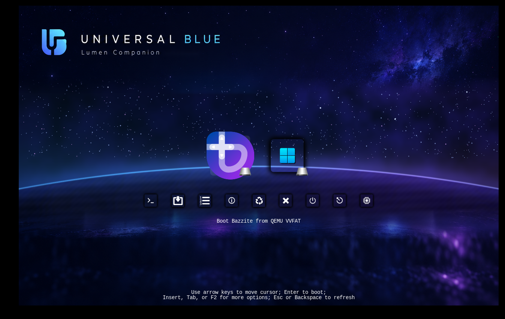

# Universal Blue Cosmic Lumen — rEFInd Theme

An **experimental 4K rEFInd theme** based on the user-approved Universal Blue cosmic / glass-card boot menu concept. Inspired by [rEFInd Lumen](https://github.com/shoxjaxon-atabayev/rEFInd-lumen) (MIT); all cards and glow effects in this package are newly composited artwork rather than a copy of Lumen's assets.

> **Visual installation candidate, not yet boot-tested.** The concept and asset preview are artistic illustrations, not actual screenshots from UEFI firmware. Real stock rEFInd positions and labels can differ; fine-tune after a boot test.



## Included files

- `background.png`: **3840×2160 RGB** starfield / galaxy / horizon wallpaper with original Universal Blue title at upper left, **without permanently baked-in menu tiles or reboot/shutdown controls**.
- `icons/os_win.png`, `os_windows.png`, `os_win11.png`, `os_win10.png`: 128px Shadow-rEFInd Windows icons. `os_linux.png`, `os_fedora.png`, and `os_unknown.png` provide Shadow-rEFInd fallback icons. `os_bazzite.png`, `os_shell.png`, and `os_rescue.png` are shared custom icons from Penguin Swarm because Shadow-rEFInd has no exact equivalents. The old illustrative `os_firmware.png` has been removed; firmware belongs in the tool row.
- `icons/func_reset.png`, `func_shutdown.png`, `func_firmware.png`, `func_about.png`, `func_exit.png`, and `tool_*.png`: original Shadow-rEFInd utility icons, configured at 48px.
- `selection_big.png`: **144×144** original Shadow-rEFInd selection graphic.
- `selection_small.png`: **64×64** original Shadow-rEFInd utility selection graphic.
- `theme.conf`: **visual overrides only**; boot logic remains in your existing configuration.
- `screenshots/`: concept and a separate *illustrative* overlay preview.

## Shadow-rEFInd icon set (visual-only revision)

This version follows the icon set used by [Penguin Swarm](https://github.com/zany130/rEFInd-bazzite-penguin-swarm): original **[Shadow-rEFInd](https://github.com/chris1111/Shadow-rEFInd)** Windows, fallback OS, utility, and selection PNGs, pinned to upstream commit `fe639d2869f59d291489c0c416c17577bd166046`. Icon sizes are **128px main row / 48px tool row**, with original 144px/64px selection images. The **Bazzite, EFI Shell and Rescue main-row icons are custom carryovers from Penguin Swarm**, because the upstream set does not contain exact equivalents; these are not falsely described as Shadow originals.

**License:** Imported Shadow-rEFInd assets are **AGPL-3.0**, not MIT; full upstream license text is bundled at `third_party/Shadow-rEFInd-AGPL-3.0.txt`. Neither the original wallpaper's rights nor other brands' marks are covered by the icon license. This PR does not edit backgrounds, EFI executables, boot entries, Secure Boot, or the existing build scripts. **The existing asset rebuild script targets the previous custom icons and may overwrite these imported files: do not run it without updating its inputs.**

## Installation (on an existing rEFInd system)

Do **not** replace or overwrite `refind.conf`, Shim, GRUB, or any `.efi` executable. First back up your existing rEFInd configuration outside the EFI System Partition:

```sh
cp /boot/efi/EFI/refind/refind.conf "$HOME/refind.conf.before-cosmic-lumen.bak"
```

Extract the **install ZIP**, open a shell in the directory containing the extracted `rEFInd-ublue-cosmic-lumen` folder, and run:

```sh
sudo cp -a rEFInd-ublue-cosmic-lumen /boot/efi/EFI/refind/themes/
```

Replace only your existing active theme `include` line in the main `/boot/efi/EFI/refind/refind.conf` with:

```conf
include themes/rEFInd-ublue-cosmic-lumen/theme.conf
```

Do not have two active theme `include` lines overriding one another. Keep all existing `scanfor`, loader paths, `volume`, `default_selection`, `dont_scan_files`, and Secure Boot configuration **unchanged**.

If desired, in **your existing working Bazzite manual stanza** set the icon path only:

```conf
icon /EFI/refind/themes/rEFInd-ublue-cosmic-lumen/icons/os_bazzite.png
```

On the user's Bazzite machine the tested loader path must remain `/EFI/fedora/shimx64.efi`. Never change it to `/EFI/fedora/grubx64.efi` to install this theme; doing so can break GRUB with `shim_lock protocol not found`.

## Difference from the design illustration

1. Stock rEFInd does not make UEFI Shell and Firmware Settings main-row boot entries just because their `os_*.png` files exist. Shell and firmware are usually **tool row** entries. Add `shell` or `firmware` to `showtools` in the main configuration if you want them enabled; if you need a custom main-row EFI Shell entry, it requires a separate valid, trusted loader definition. `Rescue Tools` similarly requires an actual EFI loader.
2. rEFInd generally labels the **currently selected** entry, not every boot option simultaneously, so the approved mockup's per-card labels are conceptual. We do not burn false labels onto icons or wallpaper.
3. This revision uses the compact Shadow-rEFInd icon style where available, with the custom Bazzite, Shell and Rescue exceptions; `selection_big.png` is its matching selection graphic. The real position of those icons is controlled by rEFInd, not exact absolute coordinates in the mockup.
4. Shadow-rEFInd's compact 128px OS and 48px utility icons may look relatively small at 3840×2160. You can adjust sizes after checking the actual display; rEFInd rescales the PNGs.
5. Background is reconstructed from the user-supplied approved concept plus procedural galaxy / planetary horizon rendering. It is designed to be faithful to the concept, **not pixel-identical** to the obscured pixels behind the original drawn menu.

## Restore previous theme

Restore your earlier `include themes/.../theme.conf` line (and previous manual Bazzite icon path, if modified), or copy back your saved config file. No bootloader binaries or firmware boot entries need changing.

## Build from source

Install Python 3, Pillow and NumPy. Run `python3 scripts/build_assets.py` from the repository root; the source package includes the approved concept and icon artwork under `source/`. The build script recreates deterministic assets from those inputs without needing network access.

## Licensing & acknowledgments

Code and original compositing scripts are MIT-licensed; source artwork rights and third-party logos are not automatically transferred by this license. The design draws inspiration from [Lumen](https://github.com/shoxjaxon-atabayev/rEFInd-lumen) (MIT) and the user-supplied Universal Blue concept. Product names and logos are the property of their respective owners. This project is **unofficial** and not affiliated with or endorsed by Universal Blue, Bazzite, Microsoft or the original Lumen author. Consult `ATTRIBUTION.md` before redistribution.
